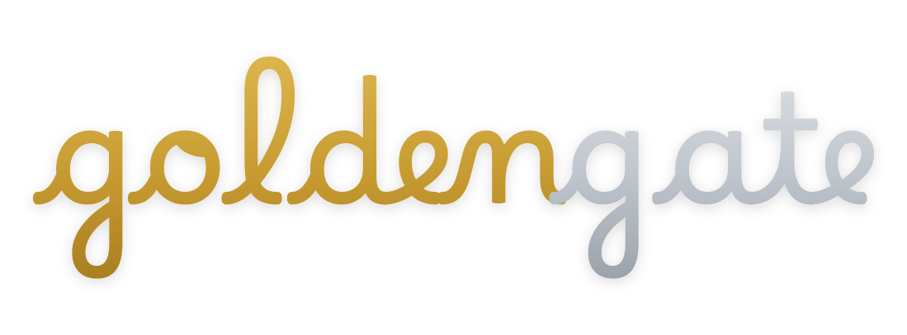

<p align="center">
  
</p>

# macOS Golden Gate Liquid Theme for Plasma 6.6+

The [Tahoe implementation](https://github.com/lestercorderomurillo/macos-tahoe-liquid-kde), with Golden Gate light/dark wallpapers selected by default. Both wallpaper sets live in Tahoe. This repository contains the downloader and one defaults parameter; the installer, themes and behavior are shared.

> [!CAUTION]
> Experimental. Desktop updates may break compatibility. Avoid production systems.

This independent community project is not affiliated with KDE, KDE e.V., or Apple Inc.

## Install

```bash
./installer
```

The first launch downloads a pinned Tahoe source archive, verifies its SHA-256, and selects `MacGoldenGate` in the shared defaults file. Later launches reuse the prepared source in `build/`. Internet is needed for the first download (about 140 MB) and missing system dependencies; Tahoe's optional Rounded Corners download remains unchanged.

The terminal entry points work the same way:

```bash
sudo ./install
sudo ./uninstall
```

All arguments pass through to Tahoe. Custom monitor backgrounds are preserved. To explicitly replace them with this edition's defaults:

```bash
sudo ./install --reset-wallpapers
```

The installed switcher keeps the selected defaults for manual, login and scheduled changes. Runtime IDs and commands retain their Tahoe names; these are two editions of the same installation, so install one at a time.

See Tahoe's [documentation](https://github.com/lestercorderomurillo/macos-tahoe-liquid-kde#readme) for supported systems, options and troubleshooting. `./legacy-install`, `./legacy-uninstall`, `./test` and `./vm` also delegate to the same source.

## Development

`defaults.json` selects the wallpaper package. `upstream.json` pins the shared source commit and archive checksum; update both together after publishing a reviewed Tahoe change. The prepared source does not update itself independently.

Test local Tahoe changes before publishing:

```bash
GOLDEN_GATE_TAHOE_SOURCE=../macos-tahoe-liquid-kde ./installer --prepare
GOLDEN_GATE_TAHOE_SOURCE=../macos-tahoe-liquid-kde ./test -q
python -m pytest tests -q
```

`--prepare` downloads/prepares the source and prints its path without launching an installer. All downloaded implementation files and build outputs stay ignored under `build/`.


Everything here is maintained independently. Thanks to the open source projects that gave inspiration for this project:

- **[EliverLara](https://github.com/EliverLara/TahoeLauncher)**: `TahoeLauncher`, the inspiration for the Launcher plasmoid.
- **[vinceliuice](https://github.com/vinceliuice)**: `MacTahoe-icon-theme`, the basis for the icons and cursors, and inspiration for the GTK look.
- **[taj-ny](https://github.com/taj-ny/kwin-effects-forceblur)** and **[4v3ngR](https://github.com/4v3ngR/kwin-effects-glass)**: Better Blur and its glass fork, the starting point of the Acrylic Glass effect.
- **[luisbocanegra](https://github.com/luisbocanegra/plasma-panel-colorizer)**: `plasma-panel-colorizer`, bundled offline to tint the panels.
- **[Matin Lotfaliei](https://github.com/matinlotfali/KDE-Rounded-Corners)**: `KDE-Rounded-Corners`, the KWin rounded-window effect built against the host KWin SDK.
- **[ful1e5](https://github.com/ful1e5)**: `apple_cursor`, inspiration for an alternate macOS-style cursor.
- **[sahibjotsaggu](https://github.com/sahibjotsaggu)**: `San-Francisco-Pro-Fonts`, where the SF Pro / SF Mono bundle comes from.
- **[Lucide](https://github.com/lucide-icons/lucide)**: copy icons bundled in the global menu.
- **[512pixels.net](https://512pixels.net/projects/default-mac-wallpapers-in-5k/)**: high-resolution macOS wallpaper archive.

Independent reimplementation inspired by the macOS aesthetic, not affiliated with or endorsed by Apple. "macOS" and "Apple" are trademarks of Apple Inc.; the bundled wallpapers and SF fonts remain Apple's property. Licensed GPL-3.0.
